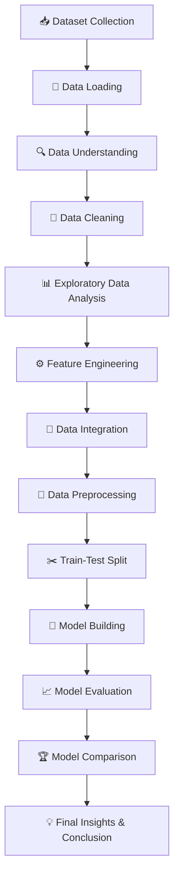

# 🏦 Home Loan Default Prediction

<p align="center">
  
  
  
  
</p>

## 📌 Project Overview

**Home Loan Default Prediction** is a Machine Learning project focused on analyzing customer financial information and predicting the likelihood of loan default.

The project aims to identify important factors influencing loan repayment behaviour, analyze customer segments, and develop predictive models that can support better and more informed lending decisions.

It involves data cleaning, Exploratory Data Analysis (EDA), feature engineering, customer segmentation, model building, and performance evaluation.

## 🎯 Project Objectives

- 📊 Perform comprehensive Exploratory Data Analysis (EDA).
- 🧹 Clean and preprocess the banking dataset.
- 🔍 Identify patterns and factors associated with loan defaults.
- 👥 Analyze customer segments based on financial and demographic characteristics.
- 🤖 Develop machine learning models to predict loan default risk.
- 📈 Compare multiple models using appropriate evaluation metrics.
- 🏆 Identify the best-performing model for potential production use.

## 📂 Dataset Description

The project uses the Home Credit Default Risk dataset, which contains customer application information and historical credit records.

**Dataset:** [Download Home Loan Default Dataset](https://d3ilbtxij3aepc.cloudfront.net/projects/CDS-Capstone-Projects/PRCP-1006-HomeLoanDef.zip)

### Dataset Files

| File Name | Description |
|---|---|
| `application_train.csv` | Main customer application data with the target variable |
| `bureau.csv` | Previous credit information from other financial institutions |
| `bureau_balance.csv` | Monthly balances of previous bureau credits |
| `POS_CASH_balance.csv` | Monthly POS and cash loan information |
| `credit_card_balance.csv` | Previous credit card balance information |
| `previous_application.csv` | Historical Home Credit loan applications |
| `installments_payments.csv` | Previous loan installment and repayment records |

### 🎯 Target Variable

The target column is `TARGET`:

- `0` – Customer did not default.
- `1` – Customer defaulted.

## 🛠️ Technologies & Tools

| Technology | Purpose |
|---|---|
| Python | Programming language |
| Pandas | Data manipulation and analysis |
| NumPy | Numerical computations |
| Matplotlib | Data visualization |
| Seaborn | Statistical visualization |
| Scikit-learn | Machine learning and evaluation |
| XGBoost | Gradient boosting classification |
| Jupyter Notebook | Project development |

## 🔄 Project Workflow



## 📊 Exploratory Data Analysis

The analysis focuses on understanding customer characteristics and identifying patterns related to loan default.

Key areas include:

- Customer age distribution.
- Income distribution.
- Credit amount analysis.
- Education and occupation analysis.
- Family and demographic information.
- Default rate distribution.
- Correlation analysis.
- Relationship between financial factors and loan default.

## ⚙️ Feature Engineering

New features can be created to improve predictive performance, including:

- Customer age in years.
- Employment experience.
- Credit-to-income ratio.
- Annuity-to-income ratio.
- Previous loan history.
- Credit utilization information.
- Historical repayment behaviour.
- Payment delays and outstanding balances.

## 🤖 Machine Learning Models

The following algorithms are considered for model development and comparison:

1. Logistic Regression
2. Decision Tree
3. Random Forest
4. Gradient Boosting
5. XGBoost

## 📈 Model Evaluation Metrics

Models are evaluated using:

- Accuracy
- Precision
- Recall
- F1-Score
- ROC-AUC
- Precision-Recall AUC
- Confusion Matrix

Special attention is given to Recall and PR-AUC because identifying potential defaulters is important in an imbalanced classification problem.

## 📁 Project Structure

```text
Home-Loan-Default-Prediction/
│
├── dataset/
│   ├── application_train.csv
│   ├── bureau.csv
│   ├── bureau_balance.csv
│   ├── POS_CASH_balance.csv
│   ├── credit_card_balance.csv
│   ├── previous_application.csv
│   └── installments_payments.csv
│
├── Home_Loan_Default_Analysis.ipynb
│
├── README.md
│
└── requirements.txt
```

## 🚀 How to Run This Project

### 1. Clone the repository

```bash
git clone https://github.com/YOUR-USERNAME/YOUR-REPOSITORY-NAME.git
```

### 2. Navigate to the project folder

```bash
cd Home-Loan-Default-Prediction
```

### 3. Install the required libraries

```bash
pip install pandas numpy matplotlib seaborn scikit-learn xgboost jupyter
```

Alternatively, if a `requirements.txt` file is available:

```bash
pip install -r requirements.txt
```

### 4. Download the dataset

Download the dataset using the link provided above and extract the CSV files into the `dataset/` folder.

### 5. Launch Jupyter Notebook

```bash
jupyter notebook
```

### 6. Run the project

Open `Home_Loan_Default_Analysis.ipynb` and execute the notebook cells sequentially.

## 💡 Expected Outcomes

- Better understanding of customer financial behaviour.
- Identification of factors associated with loan default.
- Analysis of customer segments and their default patterns.
- Comparison of multiple machine learning algorithms.
- Selection of a suitable predictive model based on evaluation results.
- Data-driven insights to support lending risk assessment.

## ⚠️ Challenges & Solutions

| Challenges | Possible Solutions |
|---|---|
| Missing values | Imputation techniques |
| Imbalanced target classes | Class weighting and threshold tuning |
| Large datasets | Efficient data processing and aggregation |
| Multiple related datasets | Customer-level feature aggregation |
| Categorical variables | Encoding techniques |
| Outliers | Statistical investigation and appropriate treatment |
| Model overfitting | Cross-validation and hyperparameter tuning |

## 📌 Project Deliverables

- ✅ Complete Exploratory Data Analysis.
- ✅ Data Cleaning and Feature Engineering.
- ✅ Predictive Machine Learning Models.
- ✅ Model Performance Comparison.
- ✅ Important Feature Identification.
- ✅ Customer Segment Analysis.
- ✅ Challenges Faced and Solutions.
- ✅ Final Jupyter Notebook.

## 🔮 Future Improvements

- Develop a user-friendly loan default prediction web application.
- Deploy the selected machine learning model using Flask or Streamlit.
- Create a real-time loan risk prediction interface.
- Improve model performance through hyperparameter optimization.
- Add explainable AI techniques to improve model interpretability.

## 👨‍💻 Author

**Sumanth Putti**

📌 Data Science | Python | Machine Learning | Data Analytics

🔗 GitHub: https://github.com/puttisumanth8790-cmd

---

<p align="center">
  ⭐ If you find this project interesting, consider giving it a star!
</p>

<p align="center">
  <b>Made with ❤️ using Python and Machine Learning</b>
</p>
